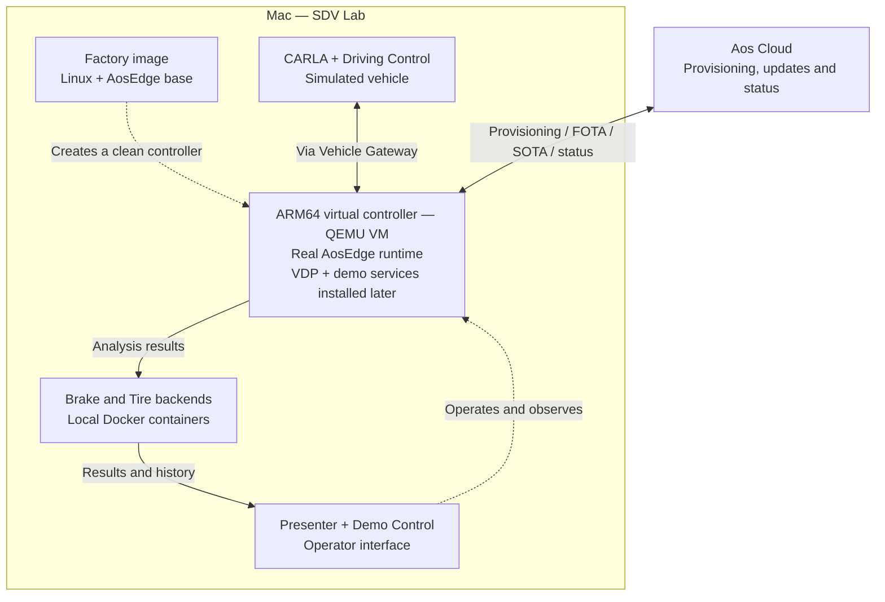

<!-- SPDX-FileCopyrightText: 2026 maninblack -->
<!-- SPDX-License-Identifier: MIT -->

# AosEdge Platform SDV Lab

AosEdge SDV Lab is a hands-on environment for exploring how to build and operate
a software-defined vehicle with a modular, orchestrated and updatable software
architecture. It demonstrates how the AosEdge platform manages the deployment,
execution and evolution of platform components and independently delivered
services—from establishing the vehicle’s software foundation to introducing
new capabilities throughout its lifecycle.

The lab combines a CARLA-simulated vehicle, an ARM64 virtual controller and the
real AosEdge platform on a Mac, connected to Aos Cloud. The vehicle and
controller hardware are simulated or virtualized; software deployment, runtime
management and updates use actual platform components.

The ARM64 virtual controller runs Linux and the AosEdge platform. It is created
from a prepared base image, referred to in this project as the **Factory image**.
This clean image supplies the software foundation; VDP and the demo services
are installed later through the platform, rather than included in the base image.

## What you can explore

- Deploy software to the virtual controller and observe its operation.
- Evolve the **Vehicle Data Platform (VDP)** component through firmware-over-the-air
  (FOTA) delivery, with installation gated by **Safe Stop**.
- Independently deploy and update **Brake and Tire** services through
  software-over-the-air (SOTA) delivery, including while the vehicle is moving.
- See vehicle-derived results, driver advisory, and local operation during a
  temporary loss of Cloud/backend connectivity.

Brake and Tire are illustrative, non-safety-related (QM) advisory services
demonstrating the platform, not AosEdge production diagnostic algorithms.
They do not control braking or steering.

## How the lab fits together



This is a component overview, not a protocol or safety-boundary diagram. CARLA
simulates the vehicle; the controller is a virtual machine running real platform
software. The service backends run locally on the Mac, separately from Aos Cloud.
See the [component map](docs/architecture/product-map.md) for responsibilities.

## Start here

**Download one launcher, run it and choose what you want to do.** You do not need
to clone repositories, find JSON files or follow separate preparation commands
before starting. Matching helpers are obtained and checksum-verified
automatically. Requirements are checked for your selected route, not all routes.

These instructions target **macOS 26 or later on Apple Silicon**. Download the
script below. A failed or partial download does not replace the completed file:

```sh
curl --fail --location --proto '=https' --proto-redir '=https' \
  --output "$HOME/Downloads/aosedge-sdv-lab.sh.download" \
  https://raw.githubusercontent.com/alexmaninblack/aosedge-sdv-demo/main/scripts/aosedge-sdv-lab.sh && \
mv "$HOME/Downloads/aosedge-sdv-lab.sh.download" "$HOME/Downloads/aosedge-sdv-lab.sh"
```

You can inspect the downloaded script in a text editor. **Only after the
download succeeds**, run it as your ordinary user, without `sudo`:

```sh
/bin/bash "$HOME/Downloads/aosedge-sdv-lab.sh"
```

The menu offers:

```text
1. Install and run the demo
2. Build the demo and installer
3. Prepare tools to rebuild the controller image or simulator
```

## Choose your route

| Choice | Use it when | What you receive |
| --- | --- | --- |
| **A / 1** | You want to use the demo without compiling | The selected DMG is downloaded and verified, then Setup opens for installation and Cloud access |
| **B / 2** | You want to reproduce the selected project build and installer | A new engineering DMG, reusing the prebuilt simulator and controller image |
| **C / 3** | You need to rebuild the controller image or vehicle simulator | Tools prepared for the selected component; source, Builder and full-build prerequisites remain separate |

The launcher shows the selected route and its plan. Existing compatible tools
and verified files are reused. Resolve a reported prerequisite, then rerun the
same downloaded file; it remembers your last route. It never silently updates
a retained checkout, formats storage, deletes your Test, moves Docker data or
publishes software to Cloud.

For a first visit, choose **A / 1** unless you need to compile. Have Docker
Desktop initialized and internet access available. You need your own Aos Cloud
OEM/SP access to operate the vehicle, but no Apple signing identity to install.
See [before you start](docs/getting-started/installed-preview-cloud-first-use.md#before-opening-setup)
for storage/memory planning and [Cloud access from scratch](docs/getting-started/installed-preview-cloud-first-use.md#new-cloud-access)
if you have no certificates. To edit source rather than reproduce a selected
build, follow [making your own changes](CONTRIBUTING.md#from-a-source-change-to-your-own-installer).

<a id="release-status"></a>

## Releases and access

See [release selection](docs/getting-started/release-status.md) for
package and access information. The launcher reads the selected version and
checksums automatically; you do not need to choose a release JSON file.
The current package is an engineering preview.

The ready-to-install DMG and all five reusable developer input archives are
delivered from Dropbox. The small catalogs and source locks live in GitHub.
Neither download route needs a Dropbox or Google login or a release-index
JSON path. Route A downloads the selected engineering DMG from its reviewed
public link, or reuses an approved local copy, and checks its exact identity. Public downloads do not grant Aos Cloud access or permission to
redistribute restricted content.

<a id="install-and-run"></a>
<a id="supported-route"></a>
<a id="a1-check-the-mac"></a>
<a id="a2-prepare-docker-once"></a>
<a id="a3-obtain-and-verify-the-complete-dmg"></a>
<a id="a4-install-through-setup"></a>
<a id="a5-connect-cloud-and-open-the-demo"></a>
<a id="a6-stop-without-deleting-your-test"></a>

## A — Install and run

Choose **1**. The script checks the Mac and existing local ARM64 Docker Engine,
verifies the selected complete DMG and signed Setup identity, then requests
opening Setup. No source checkout, Xcode, Python, Node or signing key is needed.
If Docker is missing, it explains how to install and initialize Docker Desktop.
It does not restart a running Engine or interfere with another project's data.

The download-folder question chooses the **DMG cache**, not where the demo
will be installed. See [file locations](docs/getting-started/installed-preview-cloud-first-use.md#file-locations).
An interrupted owned download resumes when you rerun the same current launcher;
it does not open Setup until the complete file passes checksum/identity checks.

In **Setup**, follow **Install SDV Lab → Connect to Aos Cloud → Open SDV Lab**.
The complete DMG already contains its matching Runtime Kit; leave it beside
Setup in the mounted image. Opening the lab displays **Presenter**, the operator
interface. **Create controller** begins the vehicle workflow; opening Presenter
alone does not start the controller, CARLA or Driving Control.

Cloud access requires one vehicle manufacturer (**OEM**) and one associated
**Service Provider (SP)** account. Use their existing certificates, or obtain
new certificates in Setup using OEM/SP issuance tokens from the official Cloud
flow. Existing certificates identify the Cloud environment; for new certificates
choose **Production** or **Staging**. Account registration remains a separate
Cloud process; the [first-use guide](docs/getting-started/installed-preview-cloud-first-use.md#new-cloud-access)
explains the two welcome emails and token fields. Credentials are not included in the DMG.

macOS may request its normal permissions during setup. Keep the image mounted
until Setup quits; afterward you can eject it and use the installed application.

This preview is not a notarized public distribution. Do not disable Gatekeeper
or bypass a macOS security refusal. The installer checks payload/storage needs
and a 90 GiB free-space reserve; the DMG size is not the installed footprint.
Your Cloud certificates and any new invitation remain personal inputs, never
included in the media or launcher cache.

Use the [installed first-use guide](docs/getting-started/installed-preview-cloud-first-use.md)
and [demo sequence](docs/operations/current-demo-workflow.md#preparation-and-version-sequence)
for actual vehicle operation. Publish one version at a time and verify it before
the next; VDP updates require Safe Stop. Stop normally and preserve Test data
and shared Docker when ending a session—deletion is a different operation.

<a id="developer-build"></a>
<a id="b1-prepare-tools-storage-and-access"></a>
<a id="b2-clone-the-one-entry-repository"></a>
<a id="b2-automatic-source-selection"></a>
<a id="b3-inspect-the-build-before-downloading-inputs"></a>
<a id="b3-automatic-checks-before-downloading-inputs"></a>
<a id="b4-prepare-build-and-locate-the-result"></a>
<a id="b4-automatic-build-and-result"></a>

## B — Build the demo and installer

Choose **2**. The developer workflow prepares tools, records the root repository's
`main` revision at the start, obtains pinned component sources and verified inputs,
checks storage, then builds and signs the engineering DMG. No additional clone
or build commands need to be copied. Have compatible Xcode and your Apple
Development signing identity available; first-run/license/system prompts remain
explicit. The [preparation reference](docs/getting-started/macos-developer-tools.md#apple-signing-access)
explains how to obtain your signing identity.

Choose an existing writable APFS parent folder on either the internal disk or
an external disk. An external SSD is useful, not mandatory. Capacity is checked
before downloads and large stages, including Docker's actual storage location.
A missing or replaced disk stops the run; it never falls back to another disk.
Shared Docker storage is not moved or restarted.
Short socket-test scratch is selected automatically on that same volume;
there is no extra path question and bulk build data stays in the workspace.

The workflow rebuilds the demo's project components and installer while
**reusing the prebuilt vehicle simulator and ARM64 virtual controller image
(Factory)**. It does not rebuild CARLA/Unreal or the controller image.
Its result is a readable DMG path under
`<workspace>/output/`, labelled `BUILD COMPLETE / CHAIN_BUILT_NOT_QUALIFIED`.
It does not install, start or upload the resulting demo. Installation is a
separate deliberate route using that candidate's matching approved inputs.
For your own result, mount the reported DMG and open **its** Setup; do not
return to A, which selects the published package. Follow
[install your build](docs/getting-started/reproduce-demo.md#install-your-build).

Downloads show the artifact name and progress. Measurable work shows byte/step
progress; other long work shows activity without an invented ETA. Temporary
work stays in `sdv/.tmp` and is cleaned by its owner. Sources, verified caches,
results and compact diagnostic logs remain reusable after interruption.

See the optional [preparation reference](docs/getting-started/macos-developer-tools.md)
or [developer build guide](docs/getting-started/reproduce-demo.md) for diagnosis,
not another required checklist. B does not build arbitrary edits in prepared
checkouts: [source changes](CONTRIBUTING.md#from-a-source-change-to-your-own-installer)
need their own committed, reviewed input selection.

<a id="heavy-dependencies"></a>
<a id="c--prepare-factory-or-simulator-tools"></a>

## C — Prepare tools to rebuild the controller image or simulator

Choose **3**, then choose **ARM64 virtual controller image (Factory)** or
**Vehicle simulator (CARLA / Unreal)**. The script checks compatible tools and
offers preparation of missing host tools, reusing the selected APFS workspace
for Python, caches and scratch. Controller-image preparation uses the Builder's
existing exact QEMU/firmware requirement. Simulator preparation checks Xcode,
Python, CMake and Ninja. Neither needs Cloud credentials, Node, Docker or a
signing key merely for this preparation.

**This route prepares host tools; it does not yet provide a turnkey full-source
build.** A retained exact-source controller-image procedure exists, but acquiring
and preparing its Linux build VM (**Builder**) remains separate. CARLA/Unreal
still needs licensed source/assets and a complete reproducible macOS recipe. The script
lists those remaining conditions and exits with an explicit partial result;
it never launches a VM or an expensive engine build to make preparation look
complete. See the [specialist guide](docs/getting-started/full-source-build.md).

## Help and project information

- [Launcher behavior and recovery](docs/getting-started/unified-macos-launcher.md)
- [Troubleshooting](docs/getting-started/troubleshooting.md)
- [Documentation map](docs/README.md)
- [Implemented architecture](docs/architecture/current-implementation.md)
- [Contributing](CONTRIBUTING.md)

This repository owns integration, orchestration, contracts and system
documentation. Components retain their own repositories and lifecycles.
There are no Git submodules and no need to reconstruct earlier experiments.

## Security and license

Keep credentials, provisioned VM disks, operational data and compiled artifacts
out of Git. See [confidential source handling](docs/governance/confidential-source-handling.md).
Original integration work is MIT-licensed under `maninblack`; component and
third-party licenses remain separate. See [LICENSE](LICENSE) and
[third-party notices](THIRD_PARTY_NOTICES.md). Public source access does not
grant restricted engine access or binary redistribution rights.
