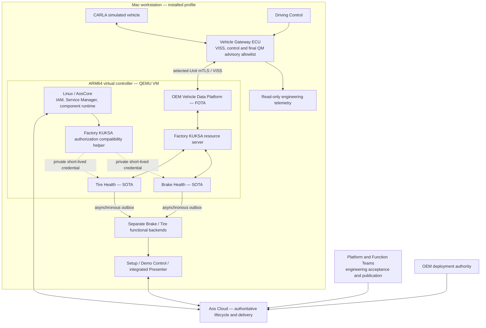

<!-- SPDX-FileCopyrightText: 2026 maninblack -->
<!-- SPDX-License-Identifier: MIT -->

# High-Level Architecture 1.8

- Status: Accepted
- Version: 1.8
- Prepared: 2026-08-22
- Accepted: 2026-09-27, with the linked accepted lifecycle/interaction amendments
- Owner: System Architecture
- Editorial consolidation: 2026-10-16; no new component, authority or requirement
- Scope: simulated vehicle, Gateway, ARM64 virtual controller, Aos Cloud,
  functional products and installation/presentation tooling
- Implementation or Cloud/Unit mutation authorized by this document: no

## Purpose

AosEdge SDV Lab demonstrates a modular, orchestratable and independently
updatable vehicle software architecture. Platform integration happens before
production; evolution is enabled by that complete baseline, not by shipping an
unfinished vehicle. Platform capabilities evolve through FOTA; independent QM
services evolve through SOTA.

CARLA supplies a simulated physical vehicle. An ARM64 virtual controller runs
real Linux/AosCore, KUKSA, platform software and containerized services. Brake
Health and Tire Health are example functional products, not algorithms supplied
by the platform. Their separate backends demonstrate asynchronous delivery;
neither local analytics nor the advisory round trip needs a Cloud round trip.

Running on one Mac does not erase the logical vehicle, Gateway, controller,
Cloud, producer-team or engineering-tool boundaries. This demonstration is
not a safety certification or a customer fleet.

## Reading and applicability

Exact schemas, stable interfaces and verification obligations belong to the
[flows](demo-scenario-architecture-flows.md),
[system requirements](../requirements/system-requirements-and-traceability.md),
[component register](../requirements/component-decomposition-and-interface-register.md)
and [D4 decisions](../requirements/d4-decision-register.md). A diagram is not
an API specification.

The installed profile uses **one OEM, one associated Service Provider and one
Test controller**. Brake and Tire retain independent service identities,
release lifecycles and product storage. The Cloud environment named Production
is not the vehicle's Production role. Certificate-selected access does not
automatically authorize another environment or vehicle.

The accepted **expanded profile** additionally separates the Function Teams
into SP1 and SP2 and exercises Validation-to-Production vehicle promotion.
Those requirements remain; they are not first-install prerequisites or
completed cross-provider/promotion claims.
[UI-STUDIO-026](../demo/mockups/aosedge-demo-interaction-specification.md#ui-studio-026--current-test-studio-contract)
defines the installed Test scope. Both profiles retain the same safety and
authority boundaries.

### Current implementation view

The [implementation map](current-implementation.md) maps design to source and
scoped proof. The [current baseline](../qualification/current-baseline.md) and
[launcher catalog](../../workspace/launcher-catalog.json) select the delivered
package. HLA does not select a Factory build or duplicate release status.

The current Factory includes explicit KUKSA scope-path compatibility and
source-timestamp patches; see the
[platform compatibility record](https://github.com/alexmaninblack/aos-vehicle-platform/blob/main/docs/contract-compatibility.md).
It is not byte-identical stock KUKSA or unmodified latest AosCore. These patches
do not move KUKSA into VDP or change KAC/IAM authority. An accepted design is
not evidence that every deferred test or capability has passed.

## System model

Credential arrows describe preparation, not a data proxy. Services connect
directly to KUKSA. Presenter reads results; it does not replace Gateway, a
service, AosCore or Aos Cloud as authority.

## Boundaries and ownership

| Boundary | Owns | Does not own |
| --- | --- | --- |
| CARLA / Vehicle Simulation | Physics, actors, simulated sensors/actuators and deterministic stimuli | Model results, Cloud lifecycle or authorization |
| Vehicle Gateway | Vehicle integration, authenticated VISS, separate control route, typed advisory validation/status | Service analytics, signing or OEM deployment decisions |
| Factory baseline assembly | Build-time composition and qualification of the immutable controller image | Provisioned vehicle identity or post-SOP releases |
| AosCore in each controller | Native workload identity, resource enforcement, lifecycle and update execution | Algorithms or a project-owned duplicate policy database |
| KUKSA / KAC | Stable resource server and removable current-release authorization bridge | FOTA ownership, product logic or motion authority |
| OEM VDP component | VISS-to-KUKSA integration and typed advisory return; independent FOTA | Service credentials or arbitrary Gateway commands |
| Brake / Tire services | Independent local models, readiness, bounded products/outboxes and advisory requests | Direct CARLA/VISS access, IAM policy or motion control |
| Functional backends | Product-specific durable ACK, queries, history and accepted model commands | Vehicle delivery lifecycle or quota enforcement |
| Aos Cloud | Authoritative Units, assignments, updates, publication and lifecycle results | Automatic engineering acceptance or a local analytics dependency |
| Demo Control / Presenter | Guarded orchestration and factual read models over existing owners | A second orchestrator, auto-approval or browser-held keys |

### Factory image, Builder and controller

The **Factory image** is the immutable pre-SOP Linux/AosEdge base for the
**ARM64 virtual controller**. A fresh writable overlay is a runtime instance.
The build-time Linux **Builder** is separate development infrastructure.
These are three different things, not interchangeable names for one VM.

The image integrates AosCore, KUKSA, KAC, security/update support and the
provider-specific empty-slot component runtime. It contains no installed VDP,
functional service, Cloud registration, per-Unit signing key, service permission
record, `AOS_SECRET` or reusable vehicle credential. Native IAM uses one
configuration with `enablePermissionsHandler: true`, independent of provisioning.
Provisioning establishes unique Unit/Node identities and per-Unit key material;
it does not repair or toggle factory IAM configuration.

VDP is delivered independently into the empty slot. Rebuild Factory for a
factory-owned delta, not every UI/service edit. Preserve the immutable image,
its source/input locks and controlled reproducibility obligations.

### Installation and local state

[ADR 0018](decisions/0018-installable-demo-and-first-use.md) allocates installation
and first-use facilitation to existing Demo Control engines. The DMG supplies
immutable program/runtime inputs. Explicit private-instance state contains
access references, release continuity, prepared outputs and working data.
Installation, runtime selection, Cloud access, controller creation and vehicle
provisioning are separate facts. Opening windows creates no vehicle journal;
Create Controller does. Window/workspace state is separate from that journal.

There is no implicit developer fallback, foreign-state adoption, replacement
of a live selected version, Finish, Cloud rollback or release-number decrement.
The [installed-state](../../contracts/distribution-installation/installed-state.md),
[selection/recovery](../../contracts/distribution-installation/version-selection.md)
and [native Setup](../../contracts/distribution-installation/native-setup.md)
contracts own exact transaction and first-use rules.

## Runtime paths

### Vehicle data and functional products

1. CARLA produces physical observations. Gateway exposes the accepted VISS
   contract with original source time and freshness.
2. The selected Unit's VDP receives authenticated VISS and publishes into
   KUKSA. Refreshing a cached value cannot make stale input fresh.
3. Authorized services subscribe directly to KUKSA and validate actual local
   inputs. Catalog presence is not live publisher/sample readiness.
4. Brake captures bounded episodes, then adds analysis and advisory across
   functional V1/V2/V3. Tire has an independent V1 estimator, summaries,
   threshold events and advisory. Only Brake requests a platform capability
   extension in this story; Tire consumes the shared VDP V3 contract.
5. Each product uses its own bounded persistent outbox and durable backend
   acknowledgement. Backend outage does not stop local analytics.

Functional profile labels are independent of monotonically allocated Cloud
release numbers. Exact signal sets, product schemas, queue limits, timing
budgets and reset semantics belong to the executable contracts, not provisional
VSS names in this overview.

### QM advisory return and vehicle control

The round trip is **service → KUKSA → VDP → VISS Set → Gateway**, with correlated
status through the accepted return path. VDP's outbound allowlist is defense
in depth; Gateway is the final deny-by-default authority for two typed QM
targets. Arbitrary VSS writes, steering, braking and safety-critical commands
are forbidden. KUKSA write success or Gateway receipt is not driver
acknowledgement or mechanical repair.

Driving Control uses a separate Gateway control route. Engineering telemetry
is a read-only Gateway/VISS observer, not a service client or second controller.
Source freshness, function readiness, advisory status and Cloud connectivity
are distinct facts. No separate in-vehicle HMI is introduced.

## Independent delivery lifecycles

The Platform Team owns Factory/VDP engineering acceptance. Each Function Team
owns its service/backend acceptance. Technical signing/publication does not
authorize OEM Unit deployment. In expanded release governance, the OEM Release
Authority explicitly authorizes exact artifact/metadata digests, permissions,
recipients and evidence after owning-team acceptance. Passing tests never
auto-approves. The installed Test UI follows its accepted scope, not an
invented Production-promotion workflow.

FOTA and SOTA are independently managed objects. The OEM component runtime
enforces fresh Safe Stop at destructive FOTA gates; publication is not
installation. QM SOTA is not gated by platform Safe Stop and can occur while
driving. Service readiness still fails closed on unsuitable actual inputs.
Native Cloud service-to-FOTA **pre-transfer admission remains deferred**;
dashboard summaries cannot masquerade as that future native capability.

Publish successive versions individually and verify each installation/result
before the next. Prepared, signed, published, assigned, downloaded, installed
and functionally ready are distinct facts. G3/G4 are derived read-only
milestones, not a combined Cloud release or another authority.

Before Apply, use native `RevertUpdate` where allowed. After Apply, repair is
a new signed forward release, not rollback of release continuity. Remove
dependent service assignments first where required. Campaign stop is not
rollback. Unknown mutation results require authoritative reconciliation, never
blind retry. Aos Cloud remains lifecycle truth; Presenter retains only bounded
local operation/recovery state and evidence references.

## Platform credential boundary

[ADR 0013](decisions/0013-current-release-kuksa-authorization-compatibility.md)
and D4-027 place **KUKSA Authorization Compatibility (`CMP-KAC`) outside VDP
and both service artifacts**. Service Manager/IAM own instance identity,
`AOS_SECRET` and registered permissions. KAC accepts only the fixed `kuksa`
resource, reads current native permissions and derives bounded JWT claims.
Callers cannot select paths, scope or TTL; no duplicate identity store or
per-service OEM policy database is added.

The bootstrap owns the secret exchange and private volatile token session.
Analytics receives a token-file path, not the native secret. It then connects
directly to KUKSA: IAM/KAC are not in the data plane. Stop/removal prevents
renewal; reboot reconstructs authority from active native workload state, not
a persisted authorization cache. Local authorization has no Cloud dependency.

Factory carries only non-secret PKCS#11/certificate-module/verifier wiring.
Provisioning creates one unique RSA signer per Unit lifecycle; only its public
verifier is installed before KAC/KUKSA start. No live key rotation/hot reload
is claimed. R0 destroys the retired signer with its overlay. KUKSA enforces
signature, audience `kuksa.val`, expiry and path permissions; it is not
credited with `iss` validation. Trusted OEM VDP uses a separate internal
Provider path; dynamic Provider IAM/JWT, per-component attestation and
malicious-Provider containment are not first-demo claims.

## Artifact trust and service inputs

[ADR 0016](decisions/0016-unsigned-packages-and-session-scoped-signing.md)
separates immutable unsigned prepared content from destination/session-specific
signatures, recipients and publication receipts. VDP uses the selected OEM
credential; each service uses its matching SP context. One associated SP can
bind both service contexts without merging their products. The expanded profile
uses SP1/SP2 separately. Native helpers are role-bound; browsers cannot choose
arbitrary keys, paths, commands or recipients and never receive private keys.

[ADR 0015](decisions/0015-use-native-aos-service-runtime-inputs.md) uses native
identity, permissions, named resources and storage. Immutable package release
metadata is provenance, not attestation or KUKSA authorization; a final OCI
digest is not an application-readiness prerequisite. Public Unit/trust inputs
are separate from private credentials and are restored before retained
assignments launch. See [service runtime inputs](demo-control-service-inputs.md).
Reusable media contains no destination secret or Unit identity; accepted source
reuse requires no historical signing key.

## Safety, connectivity and persistence

Both services are **QM maintenance/inspection examples** with no allocated
safety goal or motion authority. Containment protects already validated vehicle
functions from evolving capabilities; it does not make analytics a safety
controller. AosCore alone enforces workload resource limits; no project resource
manager is introduced.

Separate in-vehicle data/control, Unit external connectivity and presenter
administrative connectivity. The accepted external-offline control atomically
interrupts Unit-to-Cloud and service-to-backend paths, not the in-vehicle link or
presenter's Cloud access. Local models, authorization and advisory continue
under real input/lease contracts; bounded queued products deliver after
reconnect. Presenter administrative failure must not falsely label a Unit offline.

Stop is not Finish. Stop/Start preserves the same Test, identities, disks,
models, history and release continuity. Finish is explicit ownership-checked
retirement with reconciliation before local cleanup. Controller ignition
recovery restores the same connection only under accepted guards, stationary
and without Autopilot. It is neither Studio Park/Resume nor host sleep/wake
recovery. [ADR 0017](decisions/0017-continuous-demo-lifecycle-and-upstream-core.md)
defines these distinctions; qualification exclusions remain in the baseline.

## Expanded-profile obligations

A **Test Vehicle** is a Validation Unit (`VU`); an already-produced
**Production Vehicle** is a Production Unit (`PU`). Each has a fresh overlay
and its own provisioned identity, never shared credentials. Persistent dedicated
Fleet/Unit Set identities are OEM-managed; orchestration verifies them and
changes only authorized run-scoped membership. First installed Test use does
not require these expanded-profile objects.

One CARLA vehicle attaches exclusively to one role at a time. Validation and
Production use the same accepted artifact through explicit detach, canonical
reset/new generation and handover, not simultaneous cars or replayed evidence.
SP1/SP2 publication, functional backends/storage, logs and engineering decisions
remain independent. Native logs stay under their authorized Unit or Service
context without a second project archive. Full dual-role, cross-provider,
calibration, failure and resource-isolation matrices remain requirements until
their exact proof is recorded; an installed Test run does not close them.

## Out of scope and change discipline

No production hardware/CAN/Ethernet integration, safety/security certification,
malicious OEM Provider isolation, production authentication for example
backends, arbitrary VSS/motion commands, new HMI, future native workload-token
API or deferred Cloud dependency admission is claimed. Simulation, synthetic
estimates and engineering evidence must remain identified.

Maintain the current embedded diagram with this document. Earlier diagrams,
broker ownership and amendment chronology remain in
[Git history](https://github.com/alexmaninblack/aosedge-sdv-demo/blob/1a0d66f4b340bfc7b487062f7bb316623ad86af8/docs/architecture/high-level-architecture.md),
not competing instructions. The accepted design chain and stable requirement
IDs are unchanged. A substantive boundary change still requires the accepted
architecture/requirements review.
