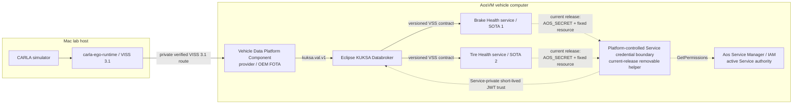

<!-- SPDX-FileCopyrightText: 2026 maninblack -->
<!-- SPDX-License-Identifier: MIT -->

# Architecture and Repository Ownership

The accepted boundary is [High-Level Architecture 1.8](high-level-architecture.md),
including installed Test, native-input, signing and lifecycle boundaries. The [implemented architecture](current-implementation.md)
and [current release evidence](../qualification/current-baseline.md) distinguish
expanded design obligations from the installed first-demo scope.

The current lab uses one OEM and one associated SP for two independent service
teams. Profile/team names below do not require two separate SP accounts.
The ARM64 virtual controller is created from a clean Linux/AosEdge Factory
image; a separate Linux Builder produces that image.

## Runtime Boundary

CARLA and VISS run on macOS. The provider, KUKSA Databroker, Service Manager
runtime, SELinux boundary, and independently deployed functional services run
in AosVM. The provider is not part of CARLA and neither service connects to
VISS directly.

The retained controller image includes documented KUKSA compatibility and
source-timestamp corrections. The diagram specifies ownership/data flow,
not byte identity with unmodified upstream binaries.

In a production vehicle, CAN, SOME/IP, DDS, or another OEM provider replaces
the simulation-specific VISS provider. KUKSA and the versioned VSS contract
remain the stable service boundary.

## Lifecycle Boundary

| Repository | Owns | Lifecycle |
| --- | --- | --- |
| `carla-ego-runtime` | ego control and VISS projection | simulation tooling |
| `aos-vehicle-platform` | Vehicle Data Platform Component source and FOTA payload; factory/rootfs integration for KUKSA with documented compatibility patches, Service Manager/IAM, the current-release removable `aos-kuksa-auth-compat` helper under `authorization/aos-kuksa-compat/`, and the OEM-trusted Provider-side KUKSA integration | OEM Platform Team; VDP FOTA and separately governed factory/system-integration artifacts |
| `brake-health-service` | Function Team 1 Brake capture, local analysis, durable outboxes and typed advisory | Independent Brake SOTA; profile `brake-sp1` |
| `tire-health-service` | Function Team 2 local tire-condition estimation, durable outbox and typed advisory | Independent Tire SOTA; profile `tire-sp2` |
| `brake-health-cloud` | Brake backend image, ingestion/query API, durable store, notifications and scoped advisory control | Function Team 1 backend; separate container and data |
| `tire-health-cloud` | Tire backend image, ingestion/query API, durable store, notifications and scoped advisory control | Function Team 2 backend; separate container and data |
| `aosedge-sdv-demo` | Setup, integrated Presenter, VM lifecycle, provisioning, signing/publication orchestration, contracts and end-to-end qualification | Solution/demo baseline |

The integration repository may pin and qualify every component, but it does
not become the source repository for those components. No Git submodule or
private local checkout path is part of a public baseline.

The [repository map](../../workspace/repository-map.json) identifies maintained
owners; immutable build selections separately pin their source revisions.
Each Function Team owns a backend repository distinct from its in-vehicle SOTA
repository. The installed lab displays both teams' results in the integrated
Presenter. Brake's source-only Dashboard is a non-live fixture; Tire has no
standalone web dashboard. Neither is another installed operator interface.
The `brake-sp1` and `tire-sp2` profile names identify independent service
bindings, not a requirement for two SP accounts in the installed topology.
See the [working baseline](../qualification/current-baseline.md) for actual
artifact and qualification boundaries.

## Trust and Network Boundary

- VISS listens only on the macOS loopback path used by the VM bridge.
- The provider verifies TLS and receives credentials through systemd, not its
  payload or command line.
- The KUKSA VAL interface remains the in-vehicle data boundary exposed to
  services (with documented compatibility/source-time patches), is factory-installed outside the VDP FOTA payload, and
  verifies only the Platform Team's configured current-release public key.
- Aos Service Manager and IAM own SOTA instance identity, `AOS_SECRET` and
  registered permissions. The separately packaged current-release helper
  translates only that current IAM result into short-lived, Service-private,
  path-scoped JWTs; it is outside the VDP and SOTA artifacts, accepts no
  caller-selected authority and stores no parallel identity or per-Service
  policy. The Provider is an OEM-qualified trusted platform component; its
  fixed KUKSA connection configuration is owned by the Platform Team and is
  not a dynamic IAM/JWT or untrusted-Provider isolation boundary. Prototype
  static tokens remain historical qualification fixtures only.
- The future native AosCore credential interface is intentionally not assigned
  to a repository until its released contract is inspected. Successful native
  migration deletes the current helper package and compatibility wiring.
- VM provisioning identity, OEM signing identity, user certificates, private
  keys, Cloud tokens, and raw operational evidence remain outside Git.
- D4-010.3 technical artifact publication is implemented once through Demo
  Control. The integrated Platform, Brake and Tire surfaces use the fixed
  `platform-oem`, `brake-sp1` and `tire-sp2` bindings. The current OEM signs VDP;
  the associated SP signs both independent services. Signing/mTLS use the
  selected owner-only PKCS#12 references, never browser or container copies.
  No repository stores those files, and technical publication never performs
  later OEM deployment approval.

## Update Boundary

The rootfs supplies the provider runtime, A/B store, launcher, systemd units,
health contract, and SELinux policy. The provider bundle supplies only its
immutable application payload and runtime libraries. Therefore provider
updates can follow their own FOTA lifecycle after a compatible rootfs is
installed.

The demonstration nested ext4 store preserves isolation on the fixed-context
AosVM workdirs mount. Production storage remains a separate OEM architecture
decision. A rootfs rollback is not assumed provider-transparent: verify the
selected image/runtime compatibility and suspend or remove an incompatible
provider assignment before changing its substrate.

See [ADR 0006](decisions/0006-lifecycle-based-repository-ownership.md) for the
accepted repository decision,
[accepted ADR 0013](decisions/0013-current-release-kuksa-authorization-compatibility.md)
for the credential boundary correction, and
[the current baseline](../qualification/current-baseline.md)
for exact versions and digests.
